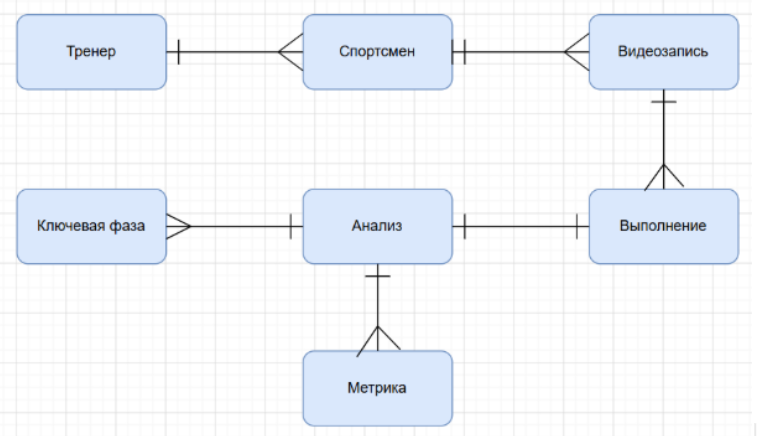

# **Техническое задание на разработку веб\-приложения**

**DiveVision – веб\-приложение для анализа техники выполнения прыжков в воду**

# **1\. Введение** 

## **1.1. Название проекта**

DiveVision – веб\-приложение для анализа выполнения прыжков в воду

## **1.2. Назначение документа**

Настоящее техническое задание определяет назначение, цели, область применения, целевую аудиторию, пользовательские роли, характеристику текущего процесса анализа прыжков в воду, а также функциональные и нефункциональные требования к веб\-приложению DiveVision.

**Кем разработан:** команда проекта в рамках образовательной программы.

**Для кого предназначен:** для участников команды разработки, преподавателя и других заинтересованных лиц, участвующих в проектировании, разработке и оценке веб\-приложения.

**Кем утверждается:** руководителем проекта / преподавателем, ответственным за проверку и приёмку работы. 

DiveVision – веб\-приложение для тренеров по прыжкам в воду, предназначенное для хранения видеозаписей выполнений спортивных элементов, визуализации и анализа результатов автоматизированного анализа видеоматериалов, а также отслеживания динамики показателей спортсменов.

Приложение предполагает использование результатов анализа, полученных с применением технологий Computer Vision, для автоматизированного выделения характеристик выполнения прыжков в воду и представления полученных данных в удобном для тренера виде.

Настоящее техническое задание является основой для последующего проектирования пользовательских сценариев, разработки прототипа интерфейса и реализации веб\-приложения.

## **1.3. Контекст проекта**

Идея проекта возникла из интереса к применению технологий Computer Vision в профессиональном спорте и возможности автоматизированного анализа спортивных элементов и движений на основе видеоматериалов.

Дополнительным стимулом для выбора данной предметной области стало обсуждение потребности в более объективном и технологичном анализе выполнения спортивных элементов на Чемпионате Европы по водным видам спорта 2026 года. В частности, внимание было обращено на возможности использования технологий компьютерного зрения для анализа выполнения прыжков в воду и получения измеримых характеристик движения спортсмена.

Проект также вдохновлён разработкой компании OMEGA, представленной для Олимпийских игр 2024 года в Париже. Технологии компьютерного зрения и многокамерного видеотрекинга, применяемые в профессиональном спорте, демонстрируют возможность автоматизированного отслеживания движения спортсмена и получения объективных параметров его выполнения.

При этом решения, использующие Computer Vision для детального анализа техники выполнения прыжков в воду, остаются относительно мало распространёнными. В частности, наблюдается ограниченное количество подобных разработок и доступных решений в данной области, в том числе на российском рынке. Это создаёт предпосылки для исследования возможностей применения технологий компьютерного зрения в тренировочном процессе.

Разработка DiveVision также связана с текущими исследовательскими и проектными задачами команды в рамках обучения на образовательной программе. Проект объединяет исследование возможностей применения Computer Vision в спорте с разработкой веб\-приложения, позволяющего представить результаты такого анализа в удобной для пользователя форме.

## **1.4. Термины и сокращения**

| Термин | Определение |
| :---- | :---- |
| Веб-приложение | Программная система, доступная пользователю через веб\-браузер и предназначенная для работы с видеозаписями и результатами анализа выполнения прыжков в воду. |
| Computer Vision (CV) | Технологии компьютерного зрения, используемые для автоматизированного анализа визуальной информации, полученной из видеозаписи. |
| Спортсмен | Спортсмен, чьи выполнения прыжков в воду фиксируются на видео и анализируются в системе. |
| Тренер | Основной пользователь системы, который работает с данными спортсменов, загружает и анализирует видеозаписи, отслеживает результаты и использует полученную информацию для корректировки тренировочного процесса. |
| Прыжок / спортивный элемент | Конкретный элемент в прыжках в воду, выполнение которого фиксируется на видео и подвергается анализу. |
| Выполнение | Одна зафиксированная на видеозаписи попытка спортсмена выполнить определённый прыжок. |
| Видеозапись | Загруженный в систему видеофайл, содержащий выполнение спортсменом определённого спортивного элемента. |
| Анализ | Результат обработки видеозаписи с использованием Computer Vision, содержащий автоматически полученные характеристики выполнения. |
| Метрика | Измеримый параметр выполнения прыжка, полученный в результате анализа видеозаписи. |
| Ключевая фаза | Выделенный в ходе анализа этап выполнения прыжка, характеризующий отдельную часть движения спортсмена. |
| История выполнений | Совокупность сохранённых видеозаписей и результатов их анализа, относящихся к одному спортсмену за определённый период. |
| Объектное хранилище | Стандартное решение для хранения медиафайлов в собственной инфраструктуре; каждый файл доступен по ссылке (ключу), которая записывается в базу данных и используется всеми модулями системы. |
| Асинхронная обработка | Режим, при котором загрузка и анализ видео идут в фоне и не блокируют работу пользователя с приложением |

**Сноска к термину «Метрика».** На текущем этапе проекта конкретный набор метрик ещё не определён. Он будет сформирован по результатам исследования возможностей применения Computer Vision к анализу прыжков в воду. В качестве потенциальных параметров могут рассматриваться временные, пространственные и кинематические характеристики выполнения. Конкретный перечень метрик будет уточнён на следующих этапах проектирования.

# **2\. Назначение и цели создания веб\-приложения**

## **2.1. Проблема**

Анализ техники выполнения прыжков в воду во многом основывается на визуальном наблюдении тренера и просмотре видеозаписей тренировок. При этом часть характеристик движения спортсмена потенциально может быть получена из видеоматериалов в измеримом виде.

При отсутствии специализированного инструмента тренеру приходится самостоятельно просматривать большое количество видеозаписей, сопоставлять различные выполнения одного элемента и отслеживать изменения характеристик спортсмена во времени. Это затрудняет систематизированный анализ тренировочных материалов и использование полученных данных при корректировке подготовки спортсмена.

В результате возникает потребность в инструменте, который позволит структурировать видеоматериалы и результаты их анализа, представить измеримые характеристики выполнения в удобном виде и использовать их для более быстрого и обоснованного анализа тренировочного процесса.

## **2.2. Назначение веб\-приложения**

DiveVision предназначено для анализа выполнения прыжков в воду на основе видеоматериалов и результатов Computer Vision-анализа.

Приложение предоставляет тренеру единое пространство для:

* хранения видеозаписей выполнения элементов спортсменами;  
* просмотра результатов автоматизированного анализа;  
* визуализации измеримых характеристик выполнения прыжков;  
* анализа отдельных фаз и характеристик движения;  
* сравнения различных выполнений;  
* отслеживания динамики показателей спортсмена.

Таким образом, приложение должно сократить время и трудозатраты тренера на обработку и сопоставление видеоматериалов, упростить выявление изменений в выполнении элементов и предоставить структурированные данные для принятия решений при планировании и корректировке подготовки спортсмена.

При этом DiveVision не предполагает замену профессиональной оценки тренера. Результаты автоматизированного анализа рассматриваются как дополнительный источник информации, который используется тренером совместно с его профессиональной экспертизой.

## **2.3. Целевая аудитория**

### **Основная целевая аудитория**

Тренеры по прыжкам в воду, работающие со спортсменами в рамках тренировочного процесса.

При использовании приложения тренер имеет возможность:

* анализировать выполнение спортивных элементов;  
* просматривать видеозаписи тренировок;  
* получать и интерпретировать измеримые характеристики выполнения;  
* сравнивать различные попытки спортсмена;  
* отслеживать динамику результатов;  
* выявлять изменения в технике выполнения;  
* использовать результаты анализа для корректировки тренировочного процесса;  
* принимать решения о дальнейшей подготовке спортсмена на основе совокупности полученных данных и профессиональной оценки.

### **Вторичная целевая аудитория**

Спортсмены по прыжкам в воду, которые могут использовать приложение для просмотра собственных результатов и отслеживания динамики выполнения элементов.

В рамках MVP функционал для роли «Спортсмен» не реализуется: спортсмен выступает только как сущность в данных тренера, без собственного доступа к системе.

### **Контекст использования приложения**

Приложение предполагается использовать в двух основных контекстах:

- В зале/у бортика бассейна, непосредственно во время или сразу после тренировки с мобильного телефона. Телефон фиксируется на штативе, ракурс подбирается в зависимости от элемента: сбоку или напротив трамплина или вышки. При использовании у бассейна необходимо учитывать особые условия эксплуатации: яркое освещение и блики на экране, работу мокрыми руками, ограниченный заряд батареи и отсутствие возможности подзарядки. Поэтому мобильный интерфейс должен быть минимально нагруженным, с крупными элементами управления и достаточным контрастом, а загрузка видео не должна быть энергозатратной и должна продолжаться в фоновом режиме.  
- Вне зала/бассейна, в свободное время с компьютера или телефона, при подготовке к тренировкам или анализе результатов после них. В этом сценарии тренер работает с историей выполнений, сравнением видео, аналитикой и динамикой показателей, что требует более развёрнутого интерфейса.

Данное разделение учитывается при проектировании пользовательских сценариев и определении приоритетности функций для мобильного и десктопного интерфейсов.

## **2.4. Цели создания веб\-приложения**

**Цель 1\. Централизовать данные о выполнениях элементов спортсменом**

Создать единое цифровое пространство для хранения видеозаписей выполнений спортивных элементов и связанных с ними результатов анализа.

**Цель 2\. Получать измеримые характеристики выполнения элементов**

Использовать результаты Computer Vision-анализа для автоматизированного получения измеримых характеристик выполнения прыжков в воду из видеоматериалов.

**Цель 3\. Визуализировать результаты анализа**

Представлять результаты анализа в понятной и наглядной форме, позволяющей тренеру быстро оценить основные характеристики конкретного выполнения и отдельных фаз движения.

**Цель 4\. Отслеживать динамику спортсмена**

Предоставить тренеру возможность отслеживать изменение показателей спортсмена на основе истории его выполнений за разные тренировочные периоды, в том числе через сводное представление ключевых метрик (дашборд), позволяющее оценить прогресс спортсмена без необходимости просматривать каждое выполнение по отдельности.

**Цель 5\. Сравнивать выполнения элементов**

Предоставить возможность сравнивать несколько выполнений одного или различных элементов для выявления изменений и различий в измеримых характеристиках.

**Цель 6\. Оптимизировать работу тренера**

Сократить время и трудозатраты тренера на обработку и сопоставление видеоматериалов за счёт автоматизированного получения и структурирования данных о выполнении.

**Цель 7\. Повысить обоснованность корректировки подготовки спортсмена**

Предоставить тренеру дополнительные объективированные данные о выполнении спортивных элементов, которые могут использоваться при выявлении проблемных характеристик, оценке прогресса и корректировке тренировочной подготовки спортсмена.

## **2.5. Задачи для достижения целей**

1. Предоставить тренеру возможность хранить информацию о спортсменах и связывать с ними результаты выполнений.  
2. Предоставить возможность загружать видеозаписи выполнения прыжков в воду и связывать их с конкретным спортсменом и спортивным элементом.  
3. Обеспечить получение результатов Computer Vision-анализа загруженного выполнения.  
4. Представлять полученные в результате анализа измеримые параметры и ключевые фазы движения спортсмена.  
5. Отображать результаты анализа непосредственно в интерфейсе приложения в форме числовых показателей, графиков и других визуальных представлений.  
6. Сохранять результаты анализа вместе с соответствующими видеозаписями и информацией о спортсмене и выполненном элементе.  
7. Предоставить тренеру возможность сопоставлять результаты разных выполнений для одного спортсмена.  
8. Формировать историю изменений показателей спортсмена и отображать её в динамике.  
9. Обеспечить тренеру доступ к структурированной информации, необходимой для выявления изменений в технике выполнения элементов.

# **3\. Характеристика объектов автоматизации**

## **3.1. Описание текущего процесса**

В настоящее время анализ техники выполнения прыжков в воду проводится тренером вручную, без использования специализированных программных инструментов.

Типовой процесс выглядит следующим образом:

1. Тренер (или ассистент) снимает выполнение спортивного элемента на видео с помощью камеры или смартфона.  
2. Видеозапись сохраняется локально на устройстве тренера – в памяти телефона, на компьютере или в личном облачном хранилище (Google Диск, мессенджеры и т. п.), без единой системы хранения и структурирования.  
3. Тренер просматривает запись вручную, при необходимости – в замедленном режиме или покадрово, встроенными средствами видеоплеера.  
4. Оценка техники выполнения основывается исключительно на визуальном наблюдении и профессиональном опыте тренера; измеримые характеристики (углы, скорости, траектории и т. д.) не фиксируются и не сохраняются.  
5. Для сравнения текущего выполнения с предыдущими тренер вынужден вручную находить и открывать старые записи, ориентируясь по названиям файлов, дате съёмки или собственной памяти.  
6. Выводы по результатам анализа тренер держит в памяти либо фиксирует неформально – в блокноте, заметках на телефоне или устно сообщает спортсмену.  
7. Полученные наблюдения используются при построении дальнейшего тренировочного процесса, но какая-либо системная история изменений показателей спортсмена не ведётся.

## **3.2. Участники процесса**

Тренер	 – проводит съёмку или организует её, самостоятельно просматривает и анализирует видеозаписи, делает выводы на основе визуального наблюдения и личного опыта

Спортсмен – выполняет спортивный элемент на камеру, получает от тренера устную обратную связь по итогам просмотра

## **3.3. Недостатки текущего процесса**

* Видеозаписи хранятся разрозненно на разных устройствах и в разных сервисах, из\-за чего их сложно найти и систематизировать.  
* Анализ выполнения полностью субъективен: тренер оценивает технику визуально, а количественные характеристики (углы вращения, высота, скорость входа в воду) не фиксируются.  
* Чтобы сравнить текущее выполнение с прошлыми, тренеру приходится вручную искать и пересматривать старые записи, что занимает много времени.  
* Изменения показателей спортсмена во времени нигде не фиксируются системно, поэтому сложно объективно оценить прогресс за тренировочный период.  
* Хранение видео на личных устройствах без резервного копирования создаёт риск потери материалов.  
* При смене тренера или необходимости показать материалы другому специалисту (например, врачу или второму тренеру) нет удобного способа передать структурированную информацию.  
* Из-за отсутствия автоматизации много времени уходит на рутинный просмотр и сопоставление видео вместо содержательного анализа техники, что удлиняет цикл обратной связи со спортсменом.

## **3.4. Ограничения и допущения проекта**

1. Первая версия приложения ориентирована на ручную загрузку видеозаписей тренером; автоматическая интеграция с камерами или системами видеофиксации на этапе MVP не предусмотрена.  
2. Конкретный набор метрик, извлекаемых средствами Computer Vision, на момент написания ТЗ не определён и будет уточнён по результатам исследования применимости CV-технологий к анализу прыжков в воду.   
3. Точность и полнота автоматизированного анализа зависят от качества исходной видеозаписи (ракурс, освещение, разрешение, наличие посторонних объектов в кадре).  
4. Роль администратора и связанный с ней функционал управления пользователями в рамках первой версии продукта не реализуются.  
5. Приложение не заменяет профессиональную экспертную оценку тренера, а дополняет её объективными измеримыми данными.  
6. Роль «Спортсмен» и связанный с ней функционал (регистрация, авторизация, просмотр собственных видеозаписей, результатов анализа и динамики показателей) не реализуются на этапе MVP. Спортсмен присутствует в системе только как объект данных, создаваемый и управляемый тренером. Функционал доступа спортсмена рассматривается как направление для развития продукта после MVP.  
7. Модуль Computer Vision-анализа рассматривается в рамках данного проекта как готовый внешний компонент, принимающий на вход видеозапись выполнения и возвращающий набор метрик и ключевых фаз движения. Разработка, обучение и совершенствование самого алгоритма компьютерного зрения выходят за рамки настоящего проекта; фокус проектирования и разработки направлен на бизнес-логику обработки, представления и использования полученных от модуля данных.  
8. Все спортсмены считаются совершеннолетними. Тренер подтверждает, что каждый дал согласие на видеосъёмку, обработку видео и передачу третьим лицам (в том числе для хранения и анализа). Работа с несовершеннолетними в MVP не предусмотрена и требует консультации с юристами.  
9. Видеозаписи рассматриваются как биометрические, то есть чувствительные персональные данные. Полная проработка соответствия законодательству о персональных данных выходит за рамки MVP.  
10. Видео хранятся в собственной инфраструктуре: на выделенном сервере в S3-совместимом объектном хранилище. Сторонние облачные хранилища в MVP не используются (юридические риски, масштабируемость). В БД хранится только ссылка на файл, остальные модули обращаются к видео по ней.  
11. Загрузка и анализ выполняются асинхронно и не блокируют работу с приложением.  
12. Приложение используется в спортивных комплексах, в том числе у бассейна.

# **4\. Требования к системе**

## **4.1. Роли пользователей**

| Роль | Назначение и основные задачи |
| :---- | :---- |
| Тренер | Основной пользователь приложения. Управляет данными спортсменов, загружает и просматривает видеозаписи, получает результаты анализа, изучает показатели, сравнивает выполнения и отслеживает динамику спортсменов. |

Спортсмен в рамках MVP не является пользователем системы, доступа к приложению не имеет. Выступает как объект данных (профиль создаётся и ведётся тренером). Роль с собственным доступом рассматривается для последующих версий продукта.

В дальнейшем может быть предусмотрена дополнительная роль администратора, отвечающего за управление пользователями и системными данными. В рамках текущей версии проекта данная роль не является приоритетной.

## **4.2. Функциональные требования**

Функциональные требования описывают действия, которые система должна выполнять для достижения целей тренера и спортсмена.

**Работа с профилями спортсменов**

FR-001: Тренер должен иметь возможность создать профиль спортсмена, указав ФИО, дату рождения и спортивную группу, чтобы связывать с ним видеозаписи и результаты анализа (Must have)

FR-001a: При создании профиля спортсмена тренер должен подтвердить, что спортсмен совершеннолетний и дал согласие на видеосъёмку, обработку и передачу видеозаписей третьим лицам. Без подтверждения профиль не создаётся (Must have).

FR-002: Тренер должен иметь возможность просмотреть список всех своих спортсменов, чтобы быстро перейти к истории конкретного спортсмена (Must have)

FR-003: Тренер должен иметь возможность редактировать и архивировать профиль спортсмена, чтобы поддерживать актуальность данных (Should have)

**Загрузка и хранение видеозаписей**

FR-004: Тренер должен иметь возможность загрузить видеозапись выполнения, указав спортсмена и спортивный элемент, чтобы сохранить её в системе (Must have)

FR-004a: Система должна автоматически создавать запись "Выполнение", связывающую видеозапись, спортсмена, элемент и дату выполнения, при загрузке видеозаписи тренером (Must have)

FR-004b: Система должна проверять видеозапись на соответствие ограничениям по формату, размеру, длительности и разрешению до начала загрузки и обработки, чтобы предотвратить перегрузку сервера и хранилища (Must have). 

FR-004c: При превышении ограничений система должна отклонить файл и сообщить, какое именно ограничение нарушено (Must have).

FR-004d: Система должна загружать и обрабатывать видео асинхронно: тренер может пользоваться приложением, пока видео загружается и анализируется, либо свернуть приложение, не прерывая загрузку (Must have).

FR-005: Система должна иметь возможность хранить видеозаписи с привязкой к дате съёмки и спортсмену, чтобы обеспечить их дальнейший поиск. Связь с элементом фиксируется через сущность "Выполнение". Видеофайлы хранятся в объектном хранилище, в базе данных хранится ссылка на файл, по которой к видео обращаются остальные модули системы (Must have)

FR-006: Тренер должен иметь возможность просмотреть список загруженных видеозаписей с фильтрацией по спортсмену, элементу и дате, чтобы быстро находить нужные материалы (Should have)

FR-007: Тренер должен иметь возможность архивировать (скрыть из активного списка) видеозапись, чтобы не терять историю для отслеживания динамики, сохраняя при этом данные для целостности статистики (Could have)

**Автоматизированный анализ видеозаписей**

FR-008: Система должна иметь возможность автоматически запускать CV-анализ после загрузки видеозаписи, чтобы получить измеримые характеристики выполнения без ручных действий тренер (Must have)

FR-009: Тренер должен иметь возможность увидеть статус обработки видеозаписи (в очереди/в обработке/готово/ошибка), чтобы понимать, когда результаты будут доступны (Must have)

FR-010: Система должна иметь возможность повторно запустить анализ при сбое обработки, чтобы тренер не терял загруженные материалы (Could have)

**Просмотр и визуализация результатов**

FR-011: Тренер должен иметь возможность просмотреть результаты анализа конкретного выполнения в виде числовых показателей и графиков, чтобы оценить технику спортсмена (Must have)

FR-012: Тренер должен иметь возможность просмотреть выделенные ключевые фазы выполнения на видео, чтобы соотнести метрики с конкретным моментом движения (Should have)

FR-013: Тренер должен иметь возможность воспроизвести видеозапись синхронно с графиком показателей, чтобы наглядно связать технику и цифры (Could have)

**Сравнение выполнений и динамика**

FR-014: Тренер должен иметь возможность выбрать два или более выполнений одного спортсмена, чтобы сравнить их метрики между собой (Must have)

FR-015: Тренер должен иметь возможность просмотреть историю показателей спортсмена по выбранному элементу за период, чтобы отследить динамику прогресса (Must have)

FR-016: Система должна иметь возможность отображать изменение метрики на графике во времени, чтобы тренер визуально видел тренд (Must have )

FR-017: Тренер должен иметь возможность просмотреть сводную панель (дашборд) с ключевыми метриками и их динамикой по выбранному спортсмену, чтобы оценить прогресс без просмотра отдельных выполнений (Must have)

FR-018: Система должна иметь возможность выгрузить сводную статистику по спортсмену в виде файла (например, PDF или CSV), чтобы тренер мог поделиться данными с другими специалистами (Could have)

**Аутентификация и доступ**

FR-019: Тренер должен иметь возможность зарегистрироваться и авторизоваться в системе под ролью «Тренер», чтобы получить доступ к своим данным (Must have)

FR-020: Тренер должен иметь возможность видеть только данные своих спортсменов, чтобы обеспечить разграничение доступа между тренерами (Must have)

## **4.3. Нефункциональные требования**

Нефункциональные требования описывают ограничения и характеристики качества системы, не связанные напрямую с конкретными функциями. 

1. Производительность

Загрузка видеозаписи весом до 500 МБ должна начинаться не более чем за 3 секунды; запуск CV-анализа – не более чем через 1 минуту после завершения загрузки. Обработка видео выполняется в фоновом режиме через очередь задач и не блокирует работу пользователей. Ограничения на размер, длительность и разрешение защищают сервер от перегрузки.

2. Надёжность

Доступность сервиса – не менее 99% в рабочее время; при сбое анализа видеозапись не должна теряться

3. Безопасность

Пароли хранятся только в хэшированном виде (bcrypt); видеозаписи и данные спортсменов доступны только тренеру, который их загрузил. Видеозаписи хранятся в собственном защищённом хранилище, доступ к файлам предоставляется только авторизованным пользователям.

4. Usability

Загрузка новой видеозаписи и запуск анализа должны занимать не более 4 кликов от главной страницы. Мобильный интерфейс пригоден для использования в условиях яркого освещения и мокрыми руками (крупные элементы управления, высокий контраст). Загрузка видео не критична к заряду батареи и возобновляется после прерывания.

5. Сопровождаемость

Код должен соответствовать единому стандарту линтинга проекта, модуль CV-анализа изолирован от остального приложения для возможности его независимого обновления

6. Портируемость

Корректная работа в последних 2 версиях Chrome, Firefox, Safari. 

7. Доступность (a11y) 

Соответствие WCAG 2.1 Level AA для основных пользовательских сценариев

8. Масштабируемость

Поддержка одновременной загрузки и обработки видео от не менее 50 пользователей без критического замедления

9. Объём хранения

Система должна поддерживать хранение видеозаписей объёмом не менее 100 ГБ на этапе MVP в собственном S3-совместимом хранилище с возможностью расширения

# **5\. Информационное обеспечение**

## **5.1. Основные сущности предметной области**

| Сущность | Описание |
| :---- | :---- |
| Тренер | Пользователь, управляющий спортсменами, видеозаписями и анализом |
| Спортсмен | Субъект, чьи выполнения фиксируются и анализируются |
| Видеозапись | Загруженный видеофайл выполнения спортивного элемента |
| Выполнение | Конкретная попытка выполнения прыжка, связанная с видеозаписью и спортсменом |
| Анализ | Результат автоматизированной обработки видеозаписи средствами Computer Vision |
| Метрика | Измеримый параметр выполнения, полученный в результате анализа |
| Ключевая фаза | Выделенный этап выполнения прыжка (например, подход, отталкивание, полет, вход в воду) |

## **5.2 Атрибуты и связи сущностей**

| Сущность | Атрибуты |
| :---- | :---- |
| Тренер | ID, ФИО, почта, пароль, список спортсменов |
| Спортсмен | ID, ID тренера, ФИО, дата рождения, группа, подтверждение согласия и совершеннолетия |
| Видеозапись | ID, ID спортсмена, название файла, дата съемки, формат, статус обработки, ссылка на файл в хранилище, размер, длительность, разрешение |
| Выполнение | ID, ID видеозаписи, спортивный элемент, дата выполнения  |
| Анализ | ID, ID выполнения, дата запуска, статус (в очереди / в обработке / готово / ошибка) |
| Метрика | ID, ID анализа, название, значение, единица измерения, привязка к временной метке  |
| Ключевая фаза | ID, ID анализа, название фазы, начальная и конечная временная метка  |

# **6\. Состав и содержание работы**

| Этап | Результат | Срок |
| :---- | :---- | :---- |
| 1\. Исследование и анализ  | Отчет по конкурентам, портрет ЦА  | Неделя 1-2 |
| 2\. Разработка ТЗ  | Документ ТЗ  | Неделя 2–3  |
| 3\. Пользовательские сценарии  | Набор сценариев и диаграмм  | Неделя 3-5 |
| 4\. Прототип в Figma | Прототип интерфейса  | Неделя 5-7 |
| 5\. Frontend-реализация  | Работающая страница с основными сценариями  | Неделя 7-10 |
| 6\. Юзабилити-тестирование  | Отчет о тестировании, исправления  | Неделя 10-12 |
| 7\. Защита проекта  | Презентация, демонстрация | Неделя 13 |

# **7\. Порядок контроля и приемки** 

## **7.1. Критерии готовности**

Ниже перечислены критерии готовности, по которым оценивается выполнение обязательных (Must have) функциональных требований, определённых в разделе 4.2. Требование считается выполненным, если реализованный функционал удовлетворяет соответствующему критерию и успешно проходит связанный с ним сценарий проверки (раздел 7.2).

| Функциональное требование | Критерий готовности |
| :---- | :---- |
| FR-001, FR-002 | Тренер может создать профиль спортсмена (ФИО, дата рождения, группа) и увидеть его в списке своих спортсменов. |
| FR-001a | Профиль не создаётся, пока тренер не подтвердил совершеннолетие спортсмена и наличие его согласия |
| FR-004, FR-005 | Тренер может загрузить видеозапись выполнения, указав спортсмена и спортивный элемент; видеозапись сохраняется в хранилище с привязкой к дате съёмки, спортсмену и элементу. |
| FR-004b, FR-004c | Файл, превышающий ограничения, отклоняется до загрузки с сообщением о нарушенном ограничении |
| FR-004d | Во время загрузки и обработки тренер может переходить по разделам приложения, загрузка не прерывается |
| FR-008 | После завершения загрузки видеозаписи система автоматически запускает CV-анализ без дополнительных действий со стороны тренера. |
| FR-009 | Тренер может увидеть текущий статус обработки загруженной видеозаписи (в очереди/в обработке/готово/ошибка), и статус корректно обновляется по мере прохождения этапов анализа. |
| FR-011 | По завершении анализа тренер может открыть выполнение и увидеть результаты в виде числовых показателей и/или графиков. |
| FR-014 | Тренер может выбрать два и более выполнений одного спортсмена и увидеть их метрики в сопоставленном виде. |
| FR-016, FR-017 | Тренер может открыть сводную панель по спортсмену и увидеть на ней ключевые метрики в динамике за выбранный период. |
| FR-019 | Пользователь может зарегистрироваться как тренер и авторизоваться под созданной учётной записью. |
| FR-020 | Тренер, авторизованный в системе, видит в своих списках и историях только данные спортсменов, которых он добавил. |

## **7.2. Сценарии проверки**

Для каждого обязательного требования предусмотрен сценарий проверки, описывающий предусловие, последовательность шагов и ожидаемый результат.

**ТС-01. Регистрация и авторизация пользователя**

Предусловие: пользователь не зарегистрирован в системе.

Шаги: 1\) открыть страницу регистрации; 2\) заполнить ФИО, email, пароль; 3\) подтвердить регистрацию; 4\) авторизоваться с указанными данными.

Ожидаемый результат: аккаунт тренера создан, пользователь авторизован и видит интерфейс приложения (FR-019).

**ТС-02. Создание профиля спортсмена**

Предусловие: тренер авторизован в системе.

Шаги: 1\) открыть раздел «Спортсмены»; 2\) нажать «Добавить спортсмена»; 3\) заполнить ФИО, дату рождения, группу; 4\) подтвердить совершеннолетие спортсмена и наличие его согласия; 5\) сохранить профиль.

Ожидаемый результат: новый спортсмен появляется в списке спортсменов тренера, профиль доступен для перехода к истории выполнений (FR-001, FR-002).

**ТС-03. Загрузка видеозаписи выполнения**

Предусловие: тренер авторизован, в системе есть хотя бы один спортсмен.

Шаги: 1\) открыть профиль спортсмена; 2\) нажать «Загрузить видео»; 3\) выбрать файл, указать спортивный элемент и дату съёмки; 4\) подтвердить загрузку.

Ожидаемый результат: видеозапись сохраняется в системе и отображается в истории выполнений спортсмена с указанными атрибутами (FR-004, FR-005).

**ТС-04. Автоматический запуск CV-анализа**

Предусловие: видеозапись успешно загружена в систему.

Шаги: 1\) дождаться завершения загрузки видеозаписи; 2\) не выполнять дополнительных действий.

Ожидаемый результат: система самостоятельно переводит выполнение в статус «в обработке», а затем – «готово», без ручного запуска анализа тренером (FR-008).

**ТС-05. Просмотр результатов анализа**

Предусловие: анализ конкретного выполнения завершён успешно.

Шаги: 1\) открыть историю выполнений спортсмена; 2\) выбрать выполнение со статусом «готово»; 3\) открыть карточку результатов.

Ожидаемый результат: тренер видит числовые показатели выполнения (или соответствующие графики), полученные в результате анализа (FR-011).

**ТС-06. Сравнение двух выполнений одного спортсмена**

Предусловие: у спортсмена есть не менее двух выполнений с завершённым анализом.

Шаги: 1\) открыть историю выполнений спортсмена; 2\) выбрать два выполнения; 3\) нажать «Сравнить».

Ожидаемый результат: система отображает метрики выбранных выполнений в сопоставленном виде, позволяя увидеть различия (FR-014).

**ТС-07. Разграничение доступа между тренерами**

Предусловие: в системе зарегистрированы два тренера, у каждого есть собственные спортсмены.

Шаги: 1\) авторизоваться под первым тренером; 2\) открыть список спортсменов; 3\) авторизоваться под вторым тренером; 4\) открыть список спортсменов.

Ожидаемый результат: каждый тренер видит только тех спортсменов, которых добавил самостоятельно; данные спортсменов другого тренера недоступны (FR-020).

**ТС-08. Загрузка видео, превышающего ограничения.**

Предусловие: тренер авторизован, есть хотя бы один спортсмен.

Шаги: 1\) открыть профиль спортсмена; 2\) нажать «Загрузить видео»; 3\) выбрать файл больше допустимого размера, длительности или разрешения; 4\) подтвердить.

Результат: система отклоняет файл и указывает нарушенное ограничение, в хранилище он не сохраняется (FR-004b, FR-004c).

**ТС-09. Асинхронная загрузка.**

Предусловие: аналогично ТС-09.

Шаги: 1\) начать загрузку видео максимально допустимого размера; 2\) во время загрузки перейти в список спортсменов и открыть другой профиль.

Результат: загрузка продолжается в фоне, интерфейс не блокируется, статус обработки виден (FR-004d, FR-009).

## **7.3. Условия приёмки**

Приёмка веб\-приложения проводится на основании демонстрации реализованных пользовательских сценариев и проверки соответствия функциональным и нефункциональным требованиям, установленным в настоящем техническом задании.

Приложение принимается при выполнении всех требований категории **Must have** и отсутствии критических ошибок, препятствующих выполнению основных пользовательских сценариев.

Требования категорий **Should have** и **Could have** могут быть реализованы частично или перенесены на последующие этапы разработки без признания основной версии приложения неготовой.
