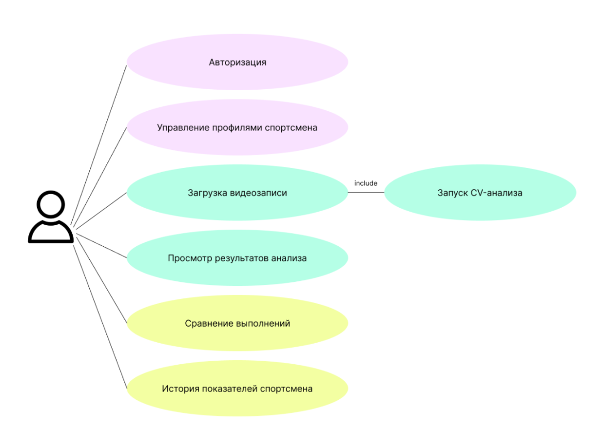
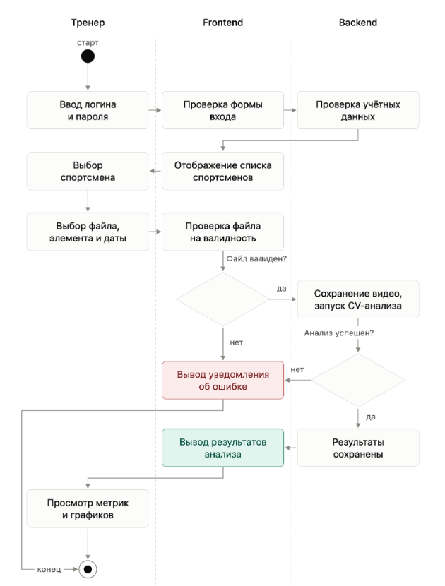

## **User Story 1 – Анализ выполнения**

Как тренер по прыжкам в воду, я хочу загрузить видеозапись выполнения элемента спортсменом и получить автоматически рассчитанные показатели и ключевые фазы прыжка,  
**чтобы быстро оценить технику выполнения и выявить характеристики, требующие дополнительной работы.**

## **User Story 2 – Сравнение выполнений**

Как тренер по прыжкам в воду, я хочу сравнить показатели нескольких выполнений элемента одним спортсменом, **чтобы увидеть различия в технике и понять, как изменилось выполнение элемента.**

## **User Story 3 – Отслеживание динамики спортсмена**

Как тренер по прыжкам в воду, я хочу видеть историю изменения показателей спортсмена за разные тренировочные периоды в динамике, **чтобы отслеживать прогресс и использовать данные при корректировке тренировочного процесса.**

## **Use Cases**

#

# **Сценарии использования (Use Cases)**

## **UC-001. Регистрация и авторизация тренера**

**Актор:** Тренер по прыжкам в воду

**Предусловие:** Тренер не зарегистрирован в системе.

**Цель:** Создать учётную запись тренера и получить доступ к функциям DiveVision.

**Основной поток (Happy Path):**

1. **Тренер** открывает страницу регистрации.  
2. **Система** отображает форму регистрации.  
3. **Тренер** вводит ФИО, email и пароль.  
4. **Система** проверяет корректность введённых данных.  
5. **Система** проверяет, что указанный email ещё не зарегистрирован.  
6. **Тренер** подтверждает регистрацию.  
7. **Система** создаёт учётную запись тренера.  
8. **Система** авторизует тренера и открывает доступ к приложению.

**Альтернативные потоки:**

**4a. Введены некорректные данные.** Система сообщает об ошибке и предлагает исправить введённые данные.

**5a. Email уже зарегистрирован.** Система сообщает, что учётная запись с таким email уже существует, и предлагает авторизоваться.

**Постусловие:** Учётная запись тренера создана, тренер авторизован в системе и может работать с данными спортсменов.

**Связь с ТЗ:**  
FR-019, FR-020.

## 

## **UC-002. Создание профиля спортсмена**

**Актор:** Тренер по прыжкам в воду

**Предусловие:** Тренер зарегистрирован и авторизован в системе.

**Цель:** Создать профиль спортсмена для дальнейшего хранения его видеозаписей и результатов анализа.

**Основной поток (Happy Path):**

1. **Тренер** выбирает возможность добавить нового спортсмена.  
2. **Система** отображает форму создания профиля спортсмена.  
3. **Тренер** вводит ФИО спортсмена, дату рождения и группу.  
4. **Система** проверяет корректность введённых данных.  
5. **Тренер** подтверждает создание профиля.  
6. **Система** создаёт профиль спортсмена и связывает его с аккаунтом тренера.  
7. **Система** отображает созданный профиль в списке спортсменов тренера.

**Альтернативные потоки:**

**4a. Не заполнены обязательные поля или введены некорректные данные.** Система сообщает об ошибке и предлагает исправить введённые данные.

**5a. Тренер отменяет создание профиля.** Система не создаёт профиль и возвращает тренера к списку спортсменов.

**Постусловие:** Профиль спортсмена создан и доступен тренеру для дальнейшей работы с видеозаписями и результатами анализа.

**Связь с ТЗ:**  
FR-001, FR-002.

## 

## **UC-003. Загрузка и автоматический анализ видеозаписи**

**Актор:** Тренер по прыжкам в воду

**Предусловие:** Тренер зарегистрирован и авторизован в системе. В системе существует профиль спортсмена, для которого загружается видеозапись.

**Цель:** Загрузить видеозапись выполнения прыжка и получить результаты автоматизированного Computer Vision-анализа.

**Основной поток (Happy Path):**

1. **Тренер** выбирает спортсмена, для которого необходимо добавить видеозапись.  
2. **Система** дает возможность добавить новое выполнение.  
3. **Тренер** выбирает видеозапись выполнения и указывает спортивный элемент и дату съёмки.  
4. **Система** проверяет загруженный файл и наличие обязательных данных.  
5. **Система** сохраняет видеозапись в хранилище, записывает ссылку на неё в БД и связывает со спортсменом и элементом. (Выполняется в фоновом режиме)  
6. **Система** автоматически запускает Computer Vision-анализ видеозаписи. (Выполняется в фоновом режиме)  
7. **Система** отображает статус обработки видеозаписи. (Выполняется в фоновом режиме)  
8. После завершения анализа **система** изменяет статус на «Готово».  
9. **Тренер** открывает результаты выполнения.  
10. **Система** отображает полученные показатели и ключевые фазы выполнения прыжка.

**Альтернативные потоки:**

**4a. Некорректный формат или параметры видеозаписи.** Система сообщает об ошибке и предлагает выбрать другую видеозапись или исправить данные. 

**6a. Анализ временно не может быть запущен.** Система сохраняет видеозапись и отображает соответствующий статус обработки.

**8a. Ошибка анализа.** Система изменяет статус на «Ошибка» и сообщает тренеру, что анализ не был завершён.

**Постусловие:** Видеозапись сохранена в системе и связана со спортсменом и спортивным элементом. При успешном завершении анализа тренер может просмотреть результаты автоматизированного анализа.

**Связь с ТЗ:**  
FR-004, FR-005, FR-004b, FR-004c, FR-004d, FR-008, FR-009, FR-009a, FR-011. 

## **UC-004. Сравнение выполнений**

**Актор:** Тренер по прыжкам в воду

**Предусловие:** Тренер авторизован в системе. У выбранного спортсмена есть как минимум два выполнения одного или сопоставимого спортивного элемента с завершённым анализом.

**Цель:** Сравнить показатели нескольких выполнений спортсмена и определить изменения в технике.

**Основной поток (Happy Path):**

1. **Тренер** открывает список выполнений выбранного спортсмена.  
2. **Система** отображает доступные выполнения и результаты их анализа.  
3. **Тренер** выбирает два или более выполнения для сравнения.  
4. **Система** проверяет, что для выбранных выполнений доступны результаты анализа.  
5. **Система** формирует сопоставление выбранных выполнений.  
6. **Система** отображает показатели выбранных выполнений в сопоставленном виде.  
7. **Тренер** сравнивает значения показателей и соответствующие фазы выполнения.  
8. **Система** позволяет тренеру использовать полученные данные для оценки изменений в выполнении элемента.

**Альтернативные потоки:**

**4a. Для одного или нескольких выбранных выполнений анализ не завершён.** Система сообщает, что сравнение доступно только для выполнений с готовыми результатами анализа, и предлагает изменить выбор.

**3a. Выбрано недостаточно выполнений для сравнения.** Система сообщает, что необходимо выбрать как минимум два выполнения.

**Постусловие:** Тренер получает сопоставленные результаты выбранных выполнений и может оценить различия в показателях и фазах выполнения.

**Связь с ТЗ:**  
FR-014.

## 

## **UC-005. Просмотр динамики показателей**

**Актор:** Тренер по прыжкам в воду

**Предусловие:** Тренер авторизован в системе. У выбранного спортсмена есть несколько выполнений с завершённым анализом.

**Цель:** Просмотреть изменение показателей спортсмена во времени и оценить динамику выполнения элемента.

**Основной поток (Happy Path):**

1. **Тренер** открывает профиль выбранного спортсмена.  
2. **Система** отображает историю его выполнений и доступные результаты анализа.  
3. **Тренер** выбирает спортивный элемент и показатель, динамику которого необходимо посмотреть.  
4. **Система** отбирает результаты выбранного показателя за доступный период.  
5. **Система** отображает изменение показателя во времени в графическом и/или числовом виде (дашборды).  
6. **Тренер** анализирует изменение показателя между тренировочными периодами.  
7. **Тренер** использует полученную информацию для оценки изменений в технике и планирования дальнейшей подготовки спортсмена.

**Альтернативные потоки:**

**4a. Недостаточно данных для построения динамики.** Система сообщает, что для выбранного показателя недостаточно результатов, и отображает доступные данные.

**3a. Для выбранного элемента отсутствуют результаты анализа.** Система сообщает об отсутствии данных и предлагает выбрать другой элемент.

**Постусловие:**  
Тренер получает представление об изменении выбранного показателя во времени и может использовать эти данные при анализе тренировочного процесса.

**Связь с ТЗ:**  
FR-015, FR-016, FR-017.

## **User Scenario**

